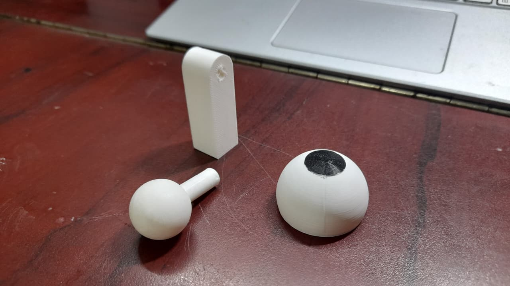
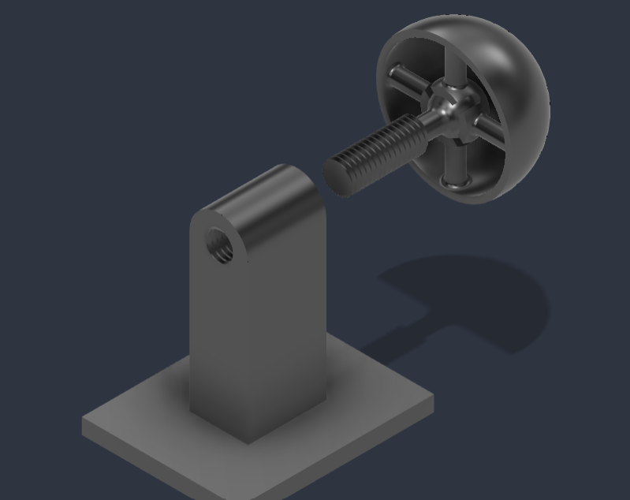
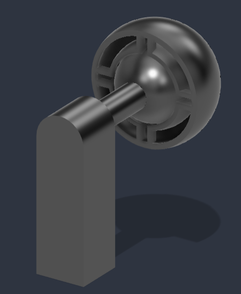
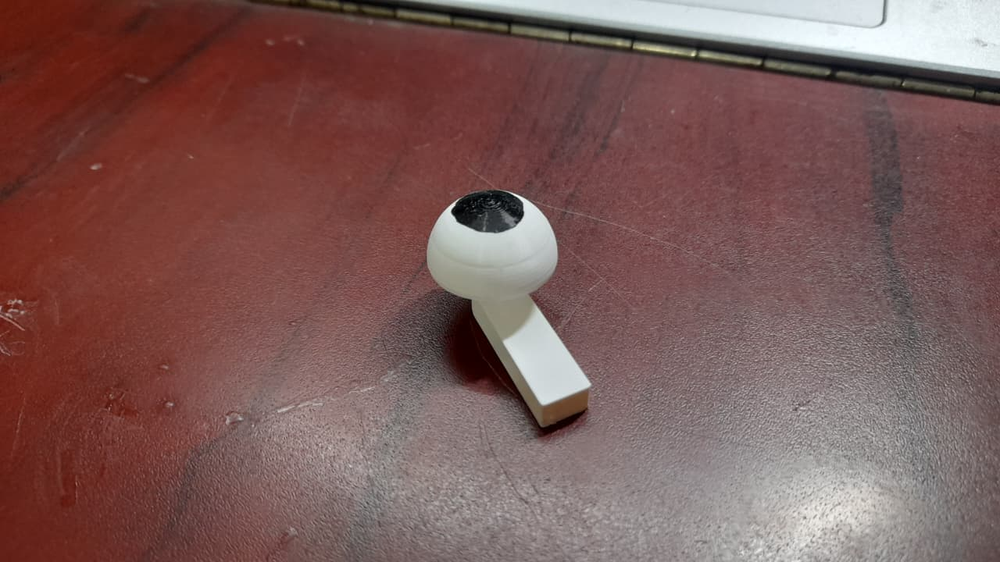
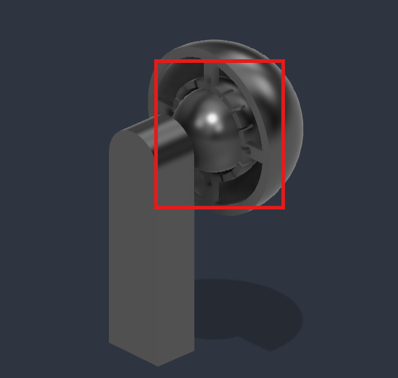

# Devlogs
Just to log my progress and any important information for future.

### Prototype 3 in CAD [14/11/2026]
I noticed that the socket was too big, and would not allow the cameras to fit in for V4. To prevent headaches later, I decided to optimize it in the prototyping stage itself. 
Just a few hours later, I broke the ball's shaft from the stand. Well, that's another good reason to make another prototype.  

 

I designed the joint on my software just after that, here are the improvements I did:
- There are now fillets on stress points like the intersection of the ball and its shaft to reduce the chances of breaking.
- The ball and socket joint is now smaller (now about 10mm, compared to prototype 2's 25mm socket), while everything else's size is the same.
- There is now a base below the stand so it can stay upright rather than tipping over.
- The gripping area of the push hooks has been optimised.
- Moved the expanding slots by 45 degrees.
- Added M8x1.25 threads to the stand and ball shaft, so they are removable by just screwing and unscrewing them. Also for better grip on the shaft when trying to pop out the eyeball. 

 

Hopefully this prints with no problems tomorrow!

### Prototype 2 [13/11/2026]
Prototype 2 is successful! The eyeball moves smoothly without a single problem today. The stand tips over, but that's not the main focus for now. 
https://github.com/user-attachments/assets/7eef68d1-a876-4764-abf5-16e7ef737c19  

Improvements noticed:
- The eyeball is now 35mm compared to prototype 1's 25mm eyeball, and the ball and socket joint is now bigger too.
- The stand is bigger as well, but it doesn't seem to fix the tipping over problem either.
- Improved the push hooks' grip area.
- The socket is now cut at a higher angle, which makes it truly snap-fit and allows the socket to hold the ball properly.
- Reduced the number of expanding slots from 16 to 4, and they're bigger as well now.

Sanded down the ball to 600 grit and added a few drops of silicon-based oil on it for even more smoothness. 

### Prototype 1 [13/11/2026]
Prototype 1 has failed. The socket is cut at a wrong angle, which makes it unable to hold the ball. The eye also seems too small right now (25mm). I'll change it to 35mm for later prototypes. The stand tips over as well. Everyone learns from mistakes!
 
 

### Schematics Mapping in KiCad [12/11/2026]
After ALOT of brainstorming, I finally decided to use the ESP32-S3 DevKitC as my microcontroller, and mapped it out on KiCad 10.0. Not that I'll make a custom PCB for this or something, but just for reference later. 
 
You may view the schematics in the Argus_Schematics folder.

### The idea [11/11/2026]
Yes, while this repository was made on 14/11/2026, the idea actually came up on this day. I just made the repository on 14th as that's the day I thought I would let the world know what I am on.

