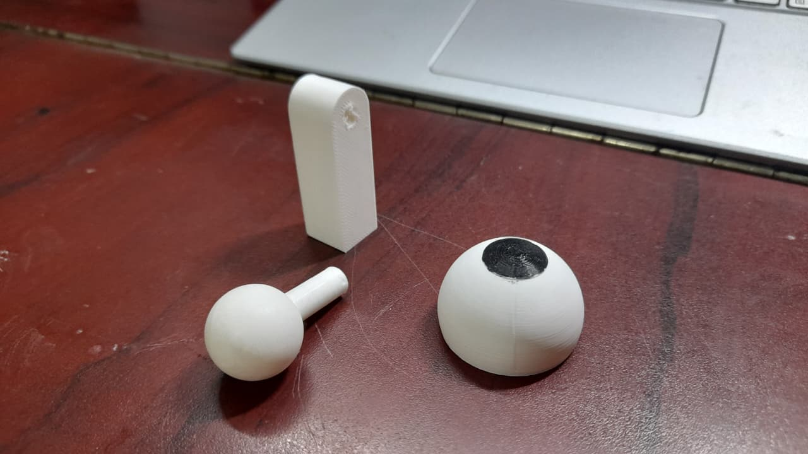
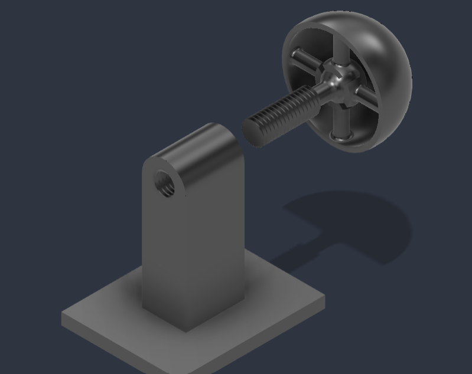
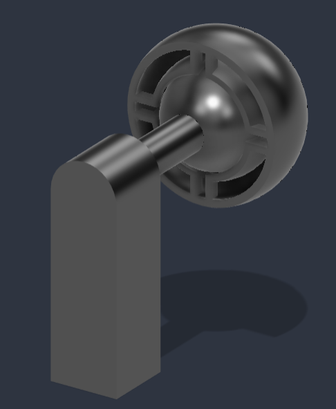
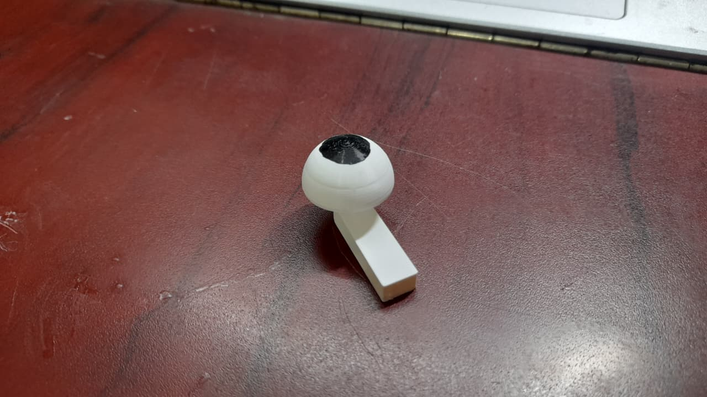
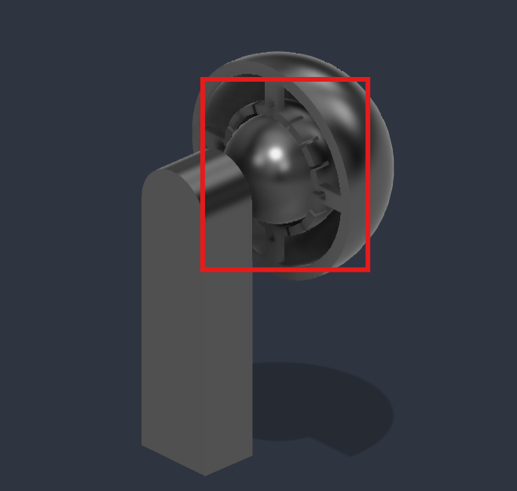

# Argus
Hello there! I am Jyotiraditya, a 13-year-old (as of me writing this on 14/11/2026) who is interested in electronics, 3D printing/modelling, mechanics, software and avionics! I recently started working on a project, which is in fact my first ever electronics project, called Argus.  
The project is open-source by MIT License. 
I had really been thinking about making a project, and I was confused between 2 options. They were a desk robot with a mic and a speaker for AI integration, and animatronic eyes with cheap components. After some thinking, I decided that I can merge these two projects into one! And there you have it, Argus was born. Argus is _planned_ to be a robot with animatronic eyes, with a mic, a speaker, a camera on each eye and a pan-tilt neck (maybe even more features if time allows and I don't lose interest). Argus is split into 4 versions rather than an all-in project. The versions are listed below

## Version Mapping

### V1 Birth:
The birth of Argus! For V1, it would just be simple animatronic eyes, inspired from a push-rod mechanism, something like this: 
 
The key difference between the mechanics shown in the image and my mechanics, is that the one in the image uses a 6 servo mechanism (Each eye has 3 servo motors, one for X, one for Y, and one for the blink). Compared to my planned 4 servo mechanism (One unified servo motor for both eyes' X-axis, one unified servo motor for both eyes' Y-axis, and one servo motor on each eye for blinking individually), it is much more cost effective and simpler to program. The motors used will be MG90S servo motors. The microcontroller will be an ESP32-S3 DevKitC. For now till V2, it will be controlled via a Bluetooth connection to my phone.

Hardware:
- ESP32-S3 DevKitC
- 4x MG90S

### V2 Kinesis:
Argus gains a pan-tilt neck! It would now be able to look around more than just its eyes' field of view. This would be a really good feature which would add up in V3 and V4. The neck will use two MG996R servo motors for movement. 

Hardware:
- 2x MG996R

### V3 Speech:
Argus is now a speaking, listening and thinking robot rather than just a kinematics project! This version will make Argus a really great project which will combine software, mechanics, 3D printing, electronics and AI all into one! It will use 2 INMP441 microphones, one towards the left and one towards the right. Why two? The INMP441 is a single-channel microphone, which means it will not be able to understand _where_ the sound is coming from. Hence, two INMP441s tell the robot where the voice is coming from, allowing it to face towards the person. The amplifier used will be MAX98357A, paired with a standard 3W 4Ω mini speaker. Now the cool part, Argus will use a local AI model to process and reply to whatever the person speaks to it, and also have thoughts sometimes. But wait! I don't have those expensive Raspberry Pi boards, neither do I want to buy one solely for this project. So, the robot will be connected to my laptop and stream data to it directly. The local AI model will run on my laptop, and stream back the information to the robot. And voila! Argus is now your companion. You can expect Argus to look similar to this when V3 is finished: 
 
(Maybe not that creepy and with two INMP441s rather than three as shown in the photo)

Hardware:
- 2x INMP441 microphones
- MAX98357A amplifier
- 3W 4Ω mini speaker

### V4 Vision:
The final version of Argus, after which I would plan to retire it and start working on something else. Inspired from MIT's Kismet robot, Argus will now have two cameras (one for each eye), mounted inside the eyes' pupils. The camera used will likely be a OV2640, used with the ESP32-CAM board. It's a really great upgrade, and allows Argus to track objects and people, and also comment on things it sees with its AI. Here is a photo of MIT's Kismet robot: 

Hardware:
- 2x OV2640 cameras
- 2x ESP32-CAM 

## Current Progress and Latest Devlogs

For the full devlog from the beginning till the latest, view [DEVLOGS.md](DEVLOGS.md). These are the latest three devlogs below.

### Prototype 3 in CAD [14/11/2026]
I noticed that the socket was too big, and would not allow the cameras to fit in for V4. To prevent headaches later, I decided to optimize it in the prototyping stage itself. 
Just a few hours later, I broke the ball's shaft from the stand. Well, that's another good reason to make another prototype.  

 

I designed the joint on my software just after that, here are the improvements I did:
- There are now fillets on stress points like the intersection of the ball and its shaft to reduce the chances of breaking.
- The ball and socket joint is now smaller (now about 10mm, compared to prototype 2's 25mm socket), while everything else's size is the same.
- There is now a base below the stand so it can stay upright rather than tipping over.
- The gripping area of the push hooks has been optimised.
- Moved the expanding slots by 45 degrees.
- Added M8x1.25 threads to the stand and ball shaft, so they are removable by just screwing and unscrewing them. Also for better grip on the shaft when trying to pop out the eyeball. 

 

Hopefully this prints with no problems tomorrow!

### Prototype 2 [13/11/2026]
Prototype 2 is successful! The eyeball moves smoothly without a single problem today. The stand tips over, but that's not the main focus for now. 
https://github.com/user-attachments/assets/7eef68d1-a876-4764-abf5-16e7ef737c19  

Improvements noticed:
- The eyeball is now 35mm compared to prototype 1's 25mm eyeball, and the ball and socket joint is now bigger too.
- The stand is bigger as well, but it doesn't seem to fix the tipping over problem either.
- Improved the push hooks' grip area.
- The socket is now cut at a higher angle, which makes it truly snap-fit and allows the socket to hold the ball properly.
- Reduced the number of expanding slots from 16 to 4, and they're bigger as well now.

Sanded down the ball to 600 grit and added a few drops of silicon-based oil on it for even more smoothness. 

### Prototype 1 [13/11/2026]
Prototype 1 has failed. The socket is cut at a wrong angle, which makes it unable to hold the ball. The eye also seems too small right now (25mm). I'll change it to 35mm for later prototypes. The stand tips over as well. Everyone learns from mistakes!
 
 

